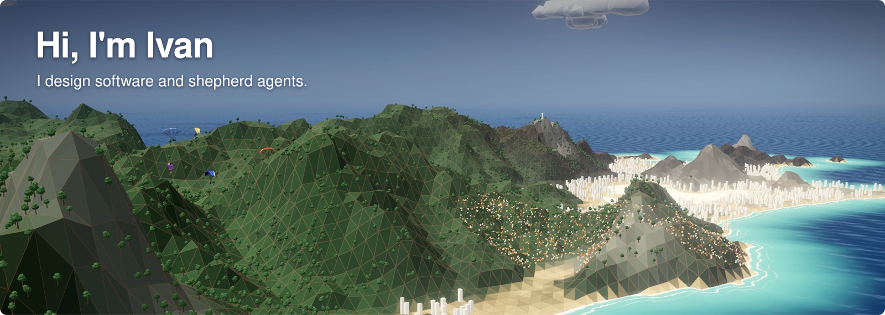
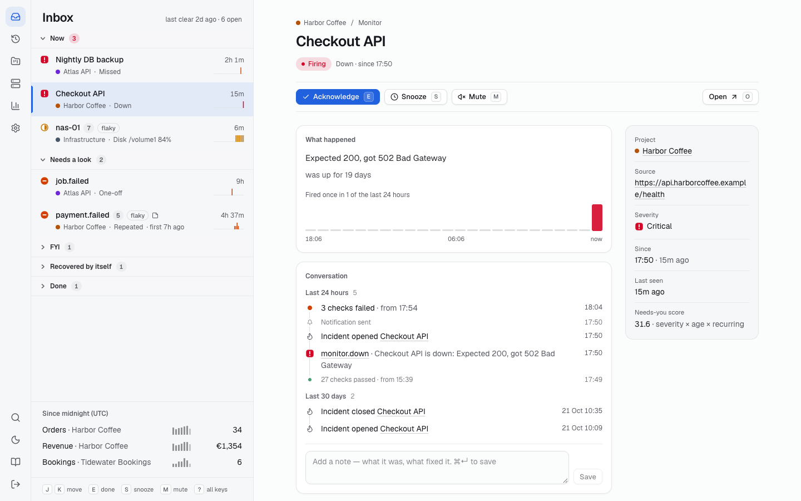
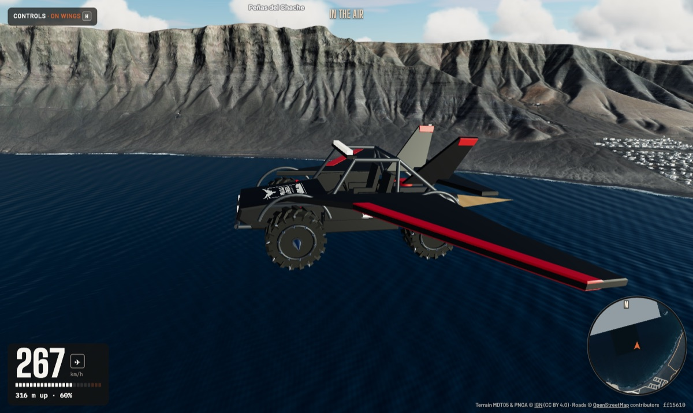
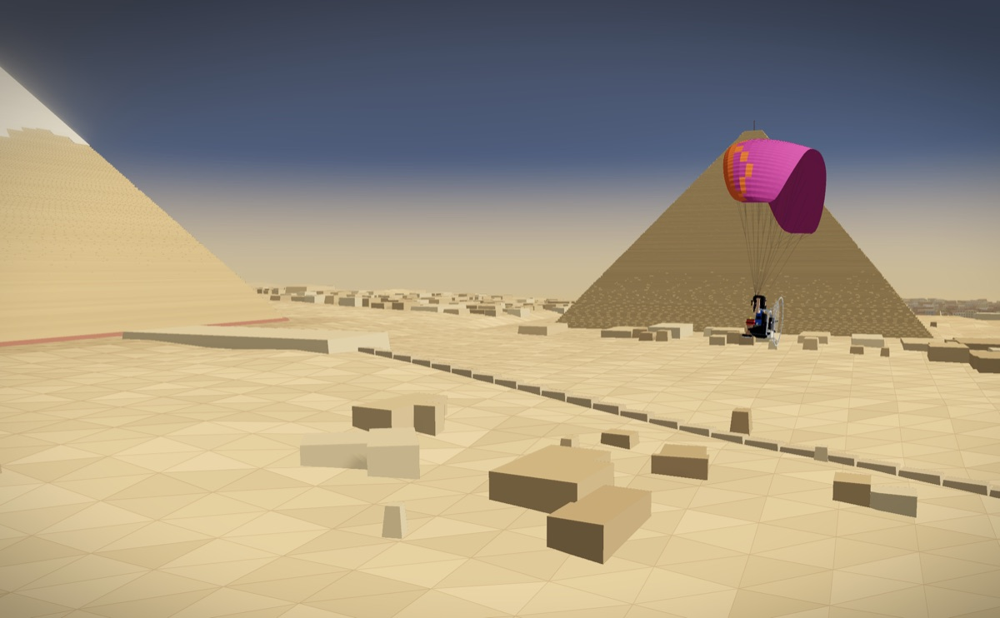
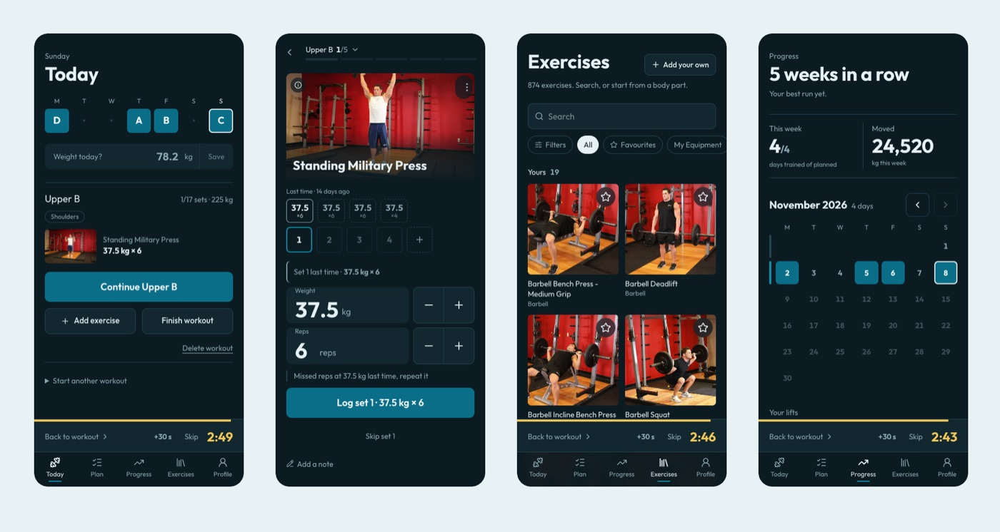

Lately I build some low poly world in the browser inspired in paragliding.

## Shepherding AI agents

<table>
  <tr>
    <td valign="top">
      <h3><a href="https://github.com/iloire/herdr-miura">Herdr Miura</a></h3>
      A desktop app on top of Herdr for running many coding agents at once. Queue up a line of prompts for each agent, review and commit what it changed, and land a finished worktree onto main in one click.  
      
       
      TypeScript · Tauri
    </td>
  </tr>
  <tr>
    <td  valign="top">
      <h3>Devil Watchdog (private)</h3>
      My agents ship all day, so something has to watch what they ship. One inbox for my sites, servers and cron jobs, and a Telegram ping when something breaks.  
      
       
      TypeScript · Next.js · Turso
    </td>
  </tr>
</table>

## For fun

<table>
  <tr>
    <td width="50%" valign="top">
      
      <h3><a href="https://github.com/iloire/driving-sim">Driving Sim</a></h3>
      A driving simulator over real places in Spain, with every OpenStreetMap road carved into the terrain. Drive the LZ-67 through Timanfaya, go off-road across the lava, or press F to take off.  
      <b><a href="https://iloire.github.io/driving-sim/">▶ Drive it in your browser</a></b> 
      TypeScript · three.js
    </td>
    <td width="50%" valign="top">
      
      <h3><a href="https://github.com/iloire/lanzarote3d">Relaxing low-poly flying scenes</a></h3>
      Pick a place and watch gliders soar its ridge: Lanzarote, Tenerife, Rio de Janeiro, paramotors in the street canyons of New York, round the Eiffel Tower or the pyramids of Giza.  
      <b><a href="https://3d.lanzaroteparagliding.com/relax.html">▶ Relax in your browser</a></b> 
      TypeScript · three.js
    </td>
  </tr>
  <tr>
    <td colspan="2" valign="top">
      <h3><a href="https://github.com/iloire/gymlog">gymlog</a></h3>
      My gym's app was so bad that I built my own. Now I ship fixes to it from my phone, between sets 😂  
       
      TypeScript · Next.js
    </td>
  </tr>
</table>

---

🪂 Lanzarote · [iloire.com](http://www.iloire.com)
